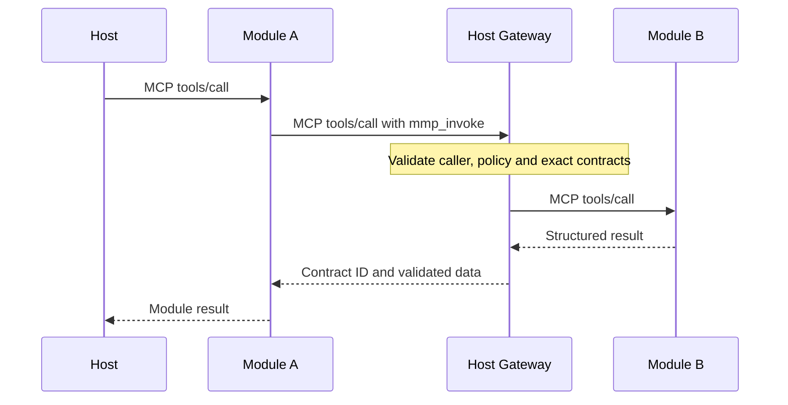

# Makora Module Protocol

**MMP 0.1.0 · Release candidate · MCP 2026-07-28**

Makora Module Protocol is an open profile of the Model Context Protocol for independently developed software modules. A module declares the capabilities it provides and the ones it needs. A Host resolves each request using a capability identifier and the exact versions of its input and output contracts.

A module can be a conventional algorithm, a model-backed service, a connector to an external system or an operation with a user interface. Its implementation is a choice for its author. The same protocol applies to systems that run entirely without AI.

[Русская версия](README.ru.md) · [Developer guide](docs/developer-guide.md) · [Specification](spec/0.1.0/overview.md) · [Release verification](docs/release-0.1.0.md)

## How MMP uses MCP

| Concern | MCP foundation | MMP profile |
| --- | --- | --- |
| Discovery | MCP servers describe tools, resources and other features. | A module descriptor adds provided and required capabilities, contract IDs, permissions and effect declarations. |
| Data | MCP tools describe arguments and can describe structured output. | Both contract IDs are required. The Host validates data against a trusted catalog with versioned schemas, semantics and examples. |
| Module calls | MCP supplies transports, request envelopes and tool calls. | A module opens a separate connection to a Host Gateway and invokes `mmp_invoke` using a declared dependency. |
| Replacement | An application can choose its tools and servers. | Compatible suppliers match the capability and both contract IDs. Policy also checks permissions and side effects. |
| Execution | MCP supplies cancellation and error mechanisms. | MMP adds rules for caller-bound contexts, chain depth and cycles, deadlines, operation outcomes and deduplication. |

For example, a schema may say that `amount` is an integer. An MMP contract also says whether it represents rubles or kopecks. Those versions have different IDs. An application that needs to convert them calls an explicit adapter. [Contract catalog](contracts/README.md)

MCP supplies the wire protocol and official SDKs. The application decides the graph, scheduling, user checkpoints, interfaces and model connections. [MCP specification](https://modelcontextprotocol.io/specification/2026-07-28) · [MCP repository](https://github.com/modelcontextprotocol/modelcontextprotocol)



## Quickstart

Install Node.js **22.13+**, Python **3.11+** and [uv](https://docs.astral.sh/uv/), then run from a checkout:

```sh
npm ci
uv sync --locked
npm run demo
```

The coordinator starts two research calls in parallel. A Python planner calls a TypeScript reviewer through the Gateway. The Host repeats the same request after substituting a Python supplier. The demo uses deterministic inputs and prints both results and call traces.

To start the browser-based Universality Lab:

```sh
uv sync --locked --project demos/universality/third-party
npm run demo:universality
```

The Lab shows the running graph, intermediate outputs and a form supplied by a module. Choose a configuration to change providers, omit an optional step or run without AI. The [Lab guide](demos/universality/README.md) covers the controlled and live model modes.

## Install the SDK

Once the release is available in the public npm registry, install it in any Node.js 22.13+ project:

```sh
npm install @artemnoor/mmp@0.1.0
```

While publication is pending, build the archive in a checkout and install it in a separate project:

```sh
# in the MMP checkout
npm ci
npm pack
```

```sh
# in the separate project
npm install /path/to/artemnoor-mmp-0.1.0.tgz
```

Both forms expose `@artemnoor/mmp`, `@artemnoor/mmp/host` and the four JSON Schemas under `@artemnoor/mmp/schemas/`. The package carries the SDK, Reference Host, schemas, templates and guides. Verify a clean install outside the checkout:

```sh
node experiments/release/sdk-consumer.mjs /path/to/artemnoor-mmp-0.1.0.tgz
node experiments/release/sdk-consumer.mjs @artemnoor/mmp@0.1.0
```

The registry mode uses `https://registry.npmjs.org/` only, fails instead of falling back to a local archive, and never publishes. [Developer guide](docs/developer-guide.md#install-the-sdk) · [Host implementer guide](docs/host-implementer.md)

## Build and integrate

- [Create a module or Host](docs/developer-guide.md) with contract declarations, nested calls, sample configuration and a conformance checklist.
- [Install the SDK](#install-the-sdk) in a separate Node project. It exports the TypeScript SDK, Reference Host and protocol JSON Schemas, with an archive fallback.
- [Implement a Host](docs/host-implementer.md) against the normative transport, trust, identity, admission and execution rules. Compatibility evidence is reported separately from this guide.
- Start with the [TypeScript and Python templates](templates/) or inspect the independent providers in the [external release experiment](experiments/release/README.md).

The [normative specification](spec/0.1.0/overview.md) and [JSON Schemas](schemas/0.1.0/) define the wire contract. The [Reference Host](reference/host/) runs pinned local packages over private stdio and an authenticated loopback Gateway. Ordinary MCP clients can use public read-only tools under the server's policy. Deduplication in the Reference Host is process-local. A deployment that accepts untrusted programs must provide OS isolation. [Security policy](SECURITY.md)

## Verify and contribute

```sh
npm run verify:release
npm run verify:external
```

The external verification builds the SDK into a tarball and installs it in a new workspace outside the checkout. It runs independently authored Node and Python providers and multiple JSON graphs through the installed public API. The [release report](docs/release-0.1.0.md) links the separate transport, browser and live model checks.

[Contributing](CONTRIBUTING.md) · [Changelog](CHANGELOG.md) · [Apache 2.0](LICENSE)
