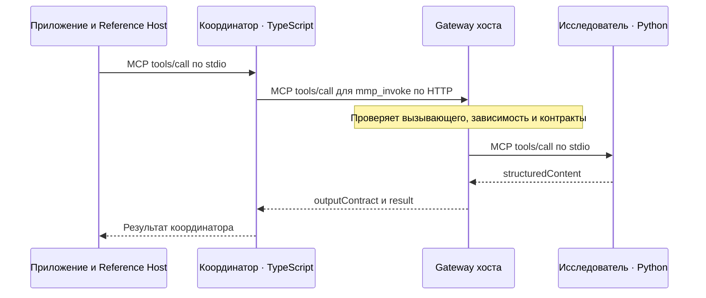

# Makora Module Protocol

**MMP 0.1.0 · Кандидат к выпуску · На базе MCP 2026-07-28**

[English](README.md) · [Руководство разработчика](docs/developer-guide.ru.md)

MMP задаёт правила, по которым независимо разработанные модули объявляют свои возможности, вызывают друг друга и заменяются в работающем приложении. Модуль запрашивает возможность по имени и точным версиям контрактов входа и выхода. Хост проверяет запрос и выбирает реализацию, которой разрешён вызов.

**Пример из репозитория.** Координатор запускает две исследовательские ветви, объединяет их данные и передаёт их планировщику на Python. Планировщик сам вызывает рецензента на TypeScript. Затем хост заменяет одного исследователя совместимой Python-реализацией, и тот же запрос снова проходит через того же координатора.

[Быстрый старт](#быстрый-старт) · [MMP и MCP](#что-mmp-добавляет-к-mcp) · [Спецификация](spec/0.1.0/overview.md) · [Лаборатория](demos/universality/README.md) · [Проверки на GitHub](https://github.com/artemnoor/makora-module-protocol/actions)

## Что MMP добавляет к MCP

[Model Context Protocol](https://modelcontextprotocol.io/specification/2026-07-28) определяет, как клиент обнаруживает и вызывает инструменты MCP-сервера, получает ресурсы и шаблоны и обменивается сообщениями. На этой основе уже можно строить рабочие процессы. MMP — самостоятельный профиль использования MCP. Он уточняет правила для приложений, которым нужны зависимости между модулями и замена реализаций по проверяемым контрактам. Спецификация, схемы и документация базового протокола находятся в [официальном репозитории MCP](https://github.com/modelcontextprotocol/modelcontextprotocol#readme).

| Вопрос | MCP | Профиль MMP 0.1 |
| --- | --- | --- |
| **Как обнаружить операцию?** | Клиент получает список инструментов конкретного сервера через `tools/list`. | Модуль также публикует дескриптор возможностей и зависимостей в `server/discover`. |
| **Как понять, что данные совместимы?** | Инструмент описывает форму аргументов и может объявить схему результата. | Для входа и выхода обязательны точные идентификаторы версионированных контрактов. Доверенный каталог хранит схему, смысл данных и примеры. |
| **Как модулю вызвать другой модуль?** | MCP определяет роли клиента и сервера, транспорт и вызов инструмента. | Модуль открывает отдельное MCP-соединение с Gateway и вызывает `mmp_invoke` для объявленной зависимости. |
| **Что происходит при замене реализации?** | Хост может выбирать серверы и инструменты по правилам приложения. | Хост проверяет совпадение возможности и обоих контрактов, а также допустимость прав доступа и побочных эффектов. |
| **Как контролируется вложенный вызов?** | MCP задаёт обмен сообщениями и механизм отмены. | Профиль добавляет правила привязки контекста к вызывающему, дедлайна, глубины вызовов, дедупликации и типизированных ошибок операции. |
| **Кто определяет порядок шагов?** | Хост или приложение. | Порядок, параллелизм, повтор по условию и ожидание человека остаются решениями приложения. |

**Зачем контракту отдельный идентификатор?** Схема с полем `amount` целочисленного типа сама по себе не объясняет, указаны рубли или копейки. В каталоге MMP это [два разных контракта](contracts/README.md). Для перехода между ними приложение явно подключает адаптер. Независимые реализации с одним контрактом обязуются одинаково интерпретировать данные.

Обычного MCP достаточно, если приложению нужно вызвать известный инструмент на выбранном сервере. Правила MMP становятся полезны, когда модули должны сами запрашивать зависимости, а хост должен уметь проверять совместимость и менять поставщика.

## Как проходит вызов



1. **Допуск.** Хост сверяет идентичность, версию и контрольные суммы локального пакета, затем проверяет дескриптор, список инструментов и схемы.
2. **Маршрутизация.** Gateway проверяет права непосредственного вызывающего и ищет поставщика по тройке `capability`, `inputContract`, `outputContract`. Выбор сохраняется на время исходного вызова.
3. **Исполнение.** Хост передаёт контекст вызова и проверяет успешный ответ по доверенной схеме. Профиль ограничивает глубину вызовов, обнаруживает циклы и определяет поведение при дедлайне, отмене и повторе. [Спецификация исполнения](spec/0.1.0/execution.md)

> На схеме показан транспорт Reference Host. В примере процессы модулей подключены по stdio, а их исходящие обращения к Gateway идут через Streamable HTTP на loopback.

## Быстрый старт

Установите Node.js **22.13 или новее**, Python **3.11 или новее** и [uv](https://docs.astral.sh/uv/).

```sh
git clone https://github.com/artemnoor/makora-module-protocol.git
cd makora-module-protocol
npm ci
uv sync --locked
npm run demo
```

Демо выводит результаты до и после замены исследователя, цепочки вызовов, идентификаторы корреляции и задержки. По умолчанию оно выполняется без AI. При необходимости исследовательский модуль можно подключить к сервису генерации через переменную `MMP_RESEARCH_PROVIDER`. Сервис принимает `POST` с `{"topic":"..."}` и возвращает `{"findings":["..."]}`. Выбор модели и её учётные данные остаются на стороне сервиса.

### Интерактивная лаборатория

После базовой установки подготовьте независимый Python-пакет и запустите приложение.

```sh
uv sync --locked --project demos/universality/third-party
npm run demo:universality
```

Откройте локальный адрес из терминала. Введите задачу и выберите одну из трёх композиций. Интерфейс покажет цепочку вызовов и промежуточный результат, а затем примет решение о следующем шаге через форму модуля. В переработанной композиции меняются порядок операций, поставщики и форма. Третья композиция работает целиком без AI. По умолчанию для воспроизводимости используется контрольный AI-адаптер. Настройка авторизованных живых моделей описана в [инструкции лаборатории](demos/universality/README.md).

## Установка SDK

После публикации установите эту версию из публичного реестра npm в любом проекте на Node.js 22.13 или новее:

```sh
npm install @artemnoor/mmp@0.1.0
```

Пока публикация ожидается, соберите архив в исходном репозитории и установите его в отдельном проекте:

```sh
# в исходном репозитории
npm ci
npm pack
```

```sh
# в своём проекте
npm install /путь/artemnoor-mmp-0.1.0.tgz
```

Обе формы дают `@artemnoor/mmp`, `@artemnoor/mmp/host` и четыре JSON Schema в `@artemnoor/mmp/schemas/`. Пакет содержит SDK, Reference Host, схемы, шаблоны и руководства. Проверьте чистую установку вне checkout:

```sh
node experiments/release/sdk-consumer.mjs /путь/artemnoor-mmp-0.1.0.tgz
node experiments/release/sdk-consumer.mjs @artemnoor/mmp@0.1.0
```

Режим реестра использует только `https://registry.npmjs.org/`, при ошибке завершается вместо перехода на локальный архив и ничего не публикует. [Руководство разработчика](docs/developer-guide.ru.md#установка-и-первый-модуль) · [Руководство по реализации Host](docs/host-implementer.md)

## Как добавить свой модуль

1. Выберите существующие [семантические контракты](spec/0.1.0/contracts.md) или опишите собственные схемы, смысл полей и примеры входа и выхода.
2. Объявите операции, их контракты и зависимости в [дескрипторе](spec/0.1.0/descriptor.md). Для TypeScript есть обёртка `createModule`. Отдельный Python-пакет показывает подключение через официальный MCP SDK и общую схему.
3. Зарегистрируйте версию, контрольные суммы и разрешения в конфигурации хоста. Если две реализации предоставляют одну возможность с теми же контрактами, хост может переключить поставщика. [Пример конфигурации](examples/config.mjs)

Готовые отправные точки — [дескриптор исследователя](examples/descriptors/research.json), [TypeScript SDK](sdk/typescript/index.ts) и [независимый Python-пакет](demos/universality/third-party/README.md).

## Что входит в репозиторий

| Раздел | Содержание |
| --- | --- |
| [Спецификация](spec/0.1.0/overview.md) и [JSON Schema](schemas/0.1.0/) | Нормативные правила и машиночитаемые схемы дескриптора, вызова, контекста и ошибки. |
| [Каталог контрактов](contracts/) | Версионированные схемы, определения смысла и проверочные примеры. |
| [SDK](sdk/typescript/) и [Reference Host](reference/host/) | Привязка к официальному MCP SDK, допуск модулей, Gateway, политика доступа и состояние вызовов. |
| [Примеры](examples/) и [Лаборатория](demos/universality/) | Межъязыковое демо, переподключение поставщиков, живые и контрольные AI-адаптеры и браузерный Harness. |
| [Тесты](conformance/) и [транспортный Spike](spike/README.md) | Проверки совместимости, политик, дедлайнов, отмены и межъязыковых вызовов. |

## Воспроизводимые проверки

```sh
npm run verify:release
uv sync --locked --project demos/universality/third-party
npx playwright install chromium
npm run verify:universality
```

Базовый набор проверяет контрактные, транспортные и защитные свойства. Лаборатория прогоняет семь типов композиции, параллельные запуски и пользовательские сценарии Chromium. Живой AI проверяется отдельной командой с авторизованным подключением. [Результаты проверки лаборатории](demos/universality/REPORT.md)

Отдельный [Spike](spike/README.md) воспроизводит транспортные проверки TypeScript и Python. Версии MCP, MMP, пакета модуля и семантического контракта учитываются независимо. [Матрица совместимости](spec/0.1.0/versioning.md) · [Матрица требований](REQUIREMENTS.md)

## Границы профиля

- **Совместимость с MCP.** MMP 0.1 использует MCP 2026-07-28. Обычный MCP-клиент может вызвать публичный инструмент только для чтения, если сервер его предоставляет. Для зависимостей и проверяемой замены поставщика нужен хост с поддержкой MMP.
- **Оркестрация и интерфейс.** Состояние процесса, граф, подключение моделей и форма принадлежат приложению. Лаборатория использует способ объявления ресурса из MCP Apps и собственный мост событий для продолжения.
- **Безопасность.** Reference Host запускает доверенные локальные пакеты, применяет правила default-deny и привязывает контекст к аутентифицированному модулю. Для запуска недоверенного кода нужна изоляция на уровне ОС. [Модель доверия](SECURITY.md)
- **Статус.** Профиль использует пространство имён `io.github.artemnoor`. Примеры используют собственные идентификаторы возможностей. В Reference Host дедупликация действует в пределах процесса. Браузерные запуски лаборатории хранятся в памяти. [Подготовка к выпуску](docs/release-0.1.0.md)

## Участие и лицензия

Предложения к контрактам и профилю можно открыть в [Issues](https://github.com/artemnoor/makora-module-protocol/issues). Порядок изменений и проверок описан в [CONTRIBUTING.md](CONTRIBUTING.md).

Проект распространяется по лицензии [Apache 2.0](LICENSE).
